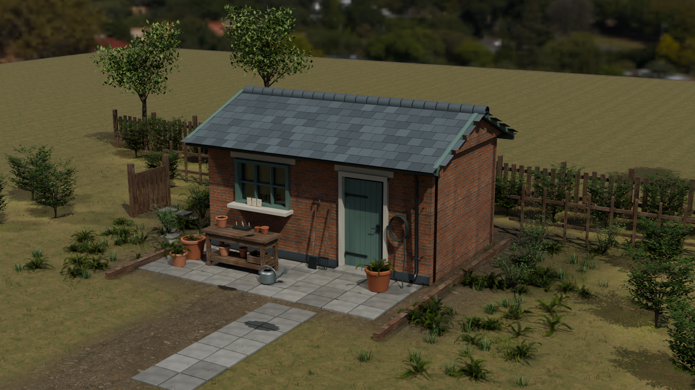

# 3D Harness

**Persistent workflows, practical skills, and measured feedback for longer Blender projects.**

3D Harness helps an agent build and revise a 3D environment while preserving its assets, materials, lighting, and project decisions across sessions. It runs above an existing Blender MCP or owned background Blender process, with the artist working through their usual agent chat.

**Status: v0.8.0 · Blender-first research prototype · one cooperating native writer.** See the [changelog](CHANGELOG.md) for version history and the [build plan](docs/BUILD_PLAN.md) for open gates and next work.



*A guided production study from the retained checkpoint history. The distant environment and inherited foliage remain unfinished. This image demonstrates a working scene, not a proven advantage over plain MCP. [Image provenance and asset credits](docs/images/README.md).*

## What it does

- **Continues from files:** retains the brief, decisions, checkpoint history, handoff notes, and unresolved operations so a fresh context can resume the project.
- **Starts from existing scenes:** previews missing identity assignments, applies the chosen plan to a new native file, and independently checks its saved identities and observation.
- **Scopes revisions:** records the intended script and preservation contract before an edit, then checks the saved result against that contract.
- **Retains deliberate artist edits:** freezes an externally saved revision for review, then accepts it with a checked contract, updated decisions, and attributed review notes.
- **Keeps review feedback actionable:** records notes against a checkpoint, object, material, or rendered view, so a fresh session sees every open issue. Responses, verification, and artist acceptance stay separate. An optional pinned seven-stage environment workflow routes the craft skills.
- **Measures native state:** observes identities, shared assets, evaluated geometry, authored/evaluated UV data, materials, image dependencies, cameras, lights, and selected render settings, with explicit coverage limits.
- **Separates technical and visual acceptance:** a candidate can pass its native checks and still be retained as a visual rejection without replacing the accepted checkpoint.
- **Supplies practical methods:** project skills cover planning, building, review, architecture, materials, environment assembly, and lighting. Python helpers support bounded construction, planting, ground, roof, terrain, and visibility tasks.
- **Supports evaluation:** frozen trial packets, fresh-context revisions, anonymous galleries, and retained failures support controlled comparisons.

The host agent provides reasoning and tool calls. The harness supplies project state and evidence; it does not start an autonomous agent or replace the existing MCP server.

## Getting started

### Requirements

- Python **3.11 or newer**. The core runtime has no third-party Python dependencies.
- Blender for native observation and authoring. Native qualification currently covers **Blender 5.1.1 on Windows**.
- An agent client with workspace access and either an existing Blender MCP connection or access to an owned background Blender process.

Clone the repository and inspect the CLI:

```sh
git clone https://github.com/cedarconnor/3D_Harness.git
cd 3D_Harness
python -m dcc_harness --help
```

Commands work directly from the checkout. For an optional editable installation on Windows:

```powershell
python -m venv .venv
.venv\Scripts\python -m pip install -e .
.venv\Scripts\python -m dcc_harness --help
```

### Activate the workflow in your agent

Open the repository in your normal Codex, Claude Code, or Cursor workspace. Where project skill discovery is available, use the `dcc-harness` entry skill. A portable explicit prompt is:

> Read `.agents/skills/dcc-harness/SKILL.md` and use its workflow to start or resume my Blender project. Preserve the accepted scene, inspect pending operations before editing, and load the craft skills relevant to the task.

The executable skills live in [`.agents/skills/`](.agents/skills/). Keep the repository available: the skills refer to its runtime and documentation. A Python wheel contains the runtime only; it does not install skills, register an MCP, or configure the client. Marketplace plugins and standalone client installers are future work.

## Everyday workflow

```text
Read brief and decisions → inspect the accepted checkpoint → reserve a scoped edit
          ↓
Execute the retained script once → save a new native file → observe and review
          ↓
Publish the checked result, or retain the rejection → write the next handoff
```

For a new project, first save an owned `.blend` and observe it with `python -m dcc_harness observe SAVED.blend --blender PATH --output-dir NEW_FOLDER`. This opens the file in a fresh background Blender, never saves it, and reports `READY` or the issues to fix. If the scene lacks stable harness identities, use [initial scene adoption](docs/guides/SCENE_ADOPTION.md): `adopt-preview` lists proposed assignments, then `adopt-apply` writes and independently observes a new file. Existing IDs are preserved; ambiguous identities block adoption. See the [everyday workflow](docs/guides/EVERYDAY_WORKFLOW.md) for preparation and exact edit commands.

Example commands below assume you have prepared your own baseline, observation, brief, decisions, and handoff files. They are not bundled demo files.

```sh
python -m dcc_harness start ./my-project/state --checkpoint ./my-project/baseline.blend --observation ./my-project/baseline.json --brief-file ./my-project/BRIEF.md --decisions ./my-project/decisions.json --handoff ./my-project/CONTINUE.md
python -m dcc_harness brief ./my-project/state
python -m dcc_harness resume ./my-project/state
python -m dcc_harness review ./my-project/state
```

| Command | Purpose |
|---|---|
| `brief` | Start here: where a project stands and the permitted next steps with filled-in commands, as Markdown |
| `next` / `requirements` | The same next steps as JSON; a stage's required evidence and a submission skeleton |
| `observe` | Observe a saved `.blend` in a fresh background Blender, without saving it, for `start`, edits and revisions |
| `render` / `render-wait` | Render a project's fixed review views of a saved `.blend` without saving it, one at a time per machine, with a bound receipt and evidence entries |
| `fill-hashes` | Fill and verify `{path, sha256}` file references in a payload, writing a new file |
| `adopt-preview` / `adopt-apply` | Preview initial identity assignments, then save and independently observe a new Blender file |
| `preview-revision` / `accept-revision` | Freeze, review and accept a deliberate saved edit into an existing project |
| `start` | Establish a continuity project from a saved native file and matching observation |
| `resume` | Verify the checkpoint chain and retrieve decisions, handoff, shared users, and pending work |
| `review` | Retrieve the current project and latest check for inspection |
| `begin-edit` | Retain a script/contract and reserve one scoped edit; execution is separate |
| `finish-edit` | Recompute checks and publish, reconcile, or retain a rejected result |
| `feedback-add` / `feedback-respond` / `feedback-verify` / `feedback-decide` | Record a note, a response with evidence, a verification, or an attributed disposition |
| `workflow-template` / `workflow-bind` | Inspect the packaged environment workflow, then pin it and its skills to a project |
| `stage-submit` / `stage-complete` / `stage-reopen` | Freeze a stage's evidence, complete it under its review policy, or reopen it |
| `check` / `diff` | Evaluate observed requirements or declared changes |
| `pack-observation` | Write a new lossless compact observation without rewriting retained evidence |

The pilot's `init`, `status`, `begin`, and `finish` journal commands remain for legacy journal-only projects. Use the commands above for new work.

If acknowledgement is lost, inspect the saved native result and reconcile it before sending another write. Direct MCP edits remain outside the reservation mechanism. Use one native writer and preserve the accepted file.

For an artist edit made outside a reservation, use [external revision review](docs/guides/EXTERNAL_REVISIONS.md). It requires a separate saved candidate, fresh observation, explicit change contract, handoff and decision updates. The workflow preserves existing history and records caller-supplied review provenance; it does not settle a pending native operation.

[Structured feedback and environment stages](docs/guides/STRUCTURED_FEEDBACK.md) are optional. Notes keep their checkpoint, object, and view anchors across sessions; implementation claims, verification, and artist acceptance remain separate records. A pinned seven-stage workflow routes the existing skills and requires current evidence before a stage completes. Coordination adds no background agent or MCP server.

## Skills

| Skill | Use |
|---|---|
| [`dcc-harness`](.agents/skills/dcc-harness/SKILL.md) | Start, resume, review, and route ordinary work |
| [`dcc-plan-environment`](.agents/skills/dcc-plan-environment/SKILL.md) | Define the brief, shared assets, constraints, and review views |
| [`dcc-build-revise`](.agents/skills/dcc-build-revise/SKILL.md) | Author scoped changes and save measured checkpoints |
| [`dcc-review-continue`](.agents/skills/dcc-review-continue/SKILL.md) | Inspect results, preserve accepted work, and prepare a handoff |
| [`dcc-architecture`](.agents/skills/dcc-architecture/SKILL.md) | Openings, dimensions, construction joins, and roof details |
| [`dcc-materials`](.agents/skills/dcc-materials/SKILL.md) | Shared material users, physical texture scale, glass, and wear |
| [`dcc-environment-assembly`](.agents/skills/dcc-environment-assembly/SKILL.md) | Ground support, planting, circulation, boundaries, and purposeful detail |
| [`dcc-lighting-review`](.agents/skills/dcc-lighting-review/SKILL.md) | Lighting intent, camera framing, and controlled comparisons |
| [`dcc-blind-test`](.agents/skills/dcc-blind-test/SKILL.md) | Coordinate explicitly requested independent comparisons |

Read [craft capabilities and recipe boundaries](docs/guides/CRAFT_SKILLS.md) before treating a skill as a general-purpose geometry or artistic-quality validator.

## Validation and current limits

The v0.8.0 source suite ran **304 tests: 302 passed, two Windows symlink-permission cases skipped**; the installed-wheel suite ran the same tests, also skipping the four that check source-tree documentation. Every version also runs native Blender fixtures; see the [0.8.0 report](docs/archive/releases/RENDER_0_8_0_RESULTS.md) for `render` and `render-wait`, the [0.7.0 report](docs/archive/releases/GUIDANCE_0_7_0_RESULTS.md) for `brief`, `next` and `requirements`, the [0.6.0 report](docs/archive/releases/STEP_COST_0_6_0_RESULTS.md) for the `observe` and `fill-hashes` commands and the [0.5.1 report](docs/archive/releases/MAINTENANCE_0_5_1_RESULTS.md) for the latest maintenance fixes. The [changelog](CHANGELOG.md) summarizes each version's evidence, and the [scripts index](scripts/README.md) lists its qualification scripts.

The [0.5.0 report](docs/archive/releases/FEEDBACK_0_5_0_RESULTS.md) covers feedback retention, evidence binding, and native revision tests. Its native exercise completed all seven workflow stages on a synthetic micro-scene. The first fresh agent exposed a missing view-definition artifact; the corrected package retains actual settings alongside their digest. In the corrected sealed trial, an independent reviewer verified three notes and left the visual note uncertain. These results test continuity mechanisms, not visual-quality improvement.

The comparisons so far have **not established a general visual-quality or long-horizon advantage** for the harness:

- In the short comparison, six independent builds and six fresh revisions all passed technical checks. Both artist-preferred entries used plain MCP.
- In the longer comparison, sixteen fresh sessions produced fourteen native-check passes and two incomplete stages. Plain MCP completed 8/8 stages and the harness 6/8.
- A realistic held-out comparison was interrupted after one partial build.

[Short comparison](docs/archive/studies/BLIND_RESULTS.md) · [Longer comparison](docs/archive/studies/CONTINUITY_RESULTS.md) · [Realistic comparison](docs/studies/REALISM_COMPARISON.md)

Current boundaries:

- Advisory execution: no native sandbox, exactly-once guarantee, external-write interception, or unattended agent scheduler.
- Collection instances are not supported yet. The observer reports any instancer as an issue, so such scenes need owned local data before `start`. External revisions also reject observed linked-library data.
- Blender qualification only; Unreal and other DCC adapters remain planned.
- Observation coverage is explicit and incomplete: animation over time, arbitrary procedural instances, rig semantics, general topology quality, and UV overlap are not certified.
- Hashes bind evidence to files; they do not authenticate producer truthfulness or establish artistic quality.
- Animation, motion graphics, broader design-taste skills, and client installers remain future work.

## Development and tests

Run the portable suite from the repository:

```sh
python -m unittest discover -s tests -v
```

Native scripts must run inside Blender. For example, this visibility fixture uses a new output directory and a separate background process:

```powershell
& 'C:/Program Files/Blender Foundation/Blender 5.1/blender.exe' --background --factory-startup --python-exit-code 1 --python scripts/qualify_visibility.py -- --repo . --out runs/my-visibility-check
```

Choose a fresh output path. Inspect the process exit code and report; a success message alone is insufficient. The [scripts index](scripts/README.md) lists each version's qualification scripts and whether they run from a fresh clone. See [validation](docs/archive/releases/VALIDATION.md) and [observer performance qualification](docs/guides/OBSERVATION_PERFORMANCE.md) for the scope of earlier tests.

## Repository guide

| Path | Contents |
|---|---|
| `dcc_harness/` | CLI, continuity store, observations, checks, review utilities, and bounded recipes |
| `.agents/skills/` | Current project skills |
| `scripts/` | Native qualification fixtures, benchmarks, asset intake, and study tooling; see the [scripts index](scripts/README.md) |
| `tests/` | Portable regression suite |
| `examples/` | Procedural courtyard example and spec |
| `experiments/` | Retained briefs, contracts, and comparison methods |
| `docs/` | The tracked [build plan](docs/BUILD_PLAN.md), decisions, guides, recipes and open studies. `docs/archive/` holds addressed work: release reports, completed studies, implemented plans, and superseded inputs. See the [documentation index](docs/README.md). |
| `runs/` | Local native files, observations, rendered galleries, and test logs; excluded from Git |

Downloaded asset kits, private photographic references, large `.blend` checkpoints, and local run galleries are not included in a clone. Some detailed reports link to those local artifacts; the written reports and representative README render are included. The example render's source assets are credited [here](docs/images/README.md).

## Further reading

- [Documentation index](docs/README.md) and [changelog](CHANGELOG.md)
- [Everyday workflow](docs/guides/EVERYDAY_WORKFLOW.md) and [continuity APIs](docs/guides/CONTINUITY_USAGE.md)
- [Structured feedback and environment stages](docs/guides/STRUCTURED_FEEDBACK.md)
- [Reference-led quality loop](docs/guides/QUALITY_LOOP_USAGE.md)
- [Craft skills](docs/guides/CRAFT_SKILLS.md) and [terrain study](docs/archive/releases/TERRAIN_0_4_7_RESULTS.md)
- [Active build plan](docs/BUILD_PLAN.md) and [design decisions](docs/DESIGN_DECISIONS.md)
- [Packaging and entry points](docs/reference/DCC_HARNESS_PACKAGING_AND_ENTRY_POINTS.md)
- [Skill and motion-design plans](docs/reference/DCC_HARNESS_SKILL_SYSTEM.md)
- [Research](docs/reference/DCC_HARNESS_RESEARCH.md) and [UE-MCP review](docs/reference/DCC_HARNESS_UE_MCP_REVIEW.md)

The active build plan and decision log take precedence over the original architecture note and historical proposals. Broader capabilities described in those studies are proposals, not shipped features.
