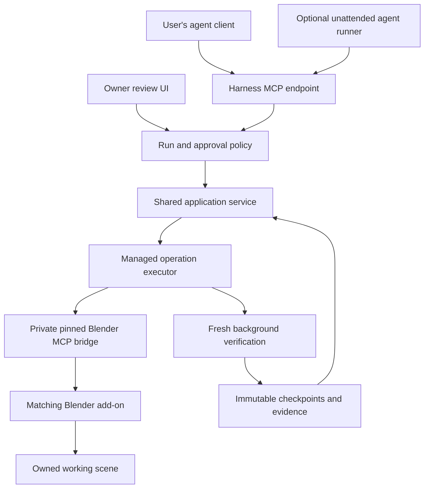

# Adversarial package review — 22 October 2026

## Decision

Keep the checkpoint, preservation, feedback and native-evidence core. Consolidate the ways an agent invokes it. Add one managed execution service with two explicit review policies, then deliver the service, skills and a pinned Blender MCP bridge as one product.

The repository is a useful Blender-first research prototype, but it is not yet an autonomous execution harness or an execution-gated MCP server. Adding an MCP wrapper to today's CLI would make the existing commands easier to reach without closing that gap.

This review found **five reproducible implementation defects and one stale native qualification fixture**. The proposed operating modes also require capabilities the current package explicitly does not claim. Those product gaps are listed separately from defects.

Review only: no runtime, tests, skills, client configuration or live artist scene was changed. Local probes and fresh background-Blender fixtures were created under `runs/adversarial-review-2026-10-22/`. This report is the only new tracked-path artifact; nothing was committed or pushed.

## Scope and evidence

Local baseline: `main`, commit `0b8c30ccbf6fd3873b40c996de24d4a8dc606ccb`, runtime **0.19.0**, initially clean. Reviewed architecture and contracts across persistence, workflow, feedback, approval, observation, preservation, rendering, delivery, spatial/UV checks, revision adoption, construction helpers, skills, experiment tooling, packaging, tests and documentation. Native probes used **Blender 5.1.1 on Windows**, in owned background processes.

Upstream integration review: [`ahujasid/mcp-for-blender`](https://github.com/ahujasid/mcp-for-blender/tree/5a3618fccb2d982d0dd61e7a1879912c3100073b), commit `5a3618fccb2d982d0dd61e7a1879912c3100073b`, package **2.2.2**. Inspected its server/connection, bundled add-on, installer, safe-mode validator, telemetry and trajectory code, package metadata and license. **Source-inspected only:** no upstream installation, client registration or live combined-server handshake was attempted.

Inventory: 52 top-level runtime Python modules / 8,436 lines; 41 test modules / 6,314 lines; 84 scripts / 6,704 lines; 35 project skills; 96 Markdown documents under `docs`; 42 root CLI commands, including the internal `render-job` command. Size is not itself a defect. The costly complexity is the number of separate protocols and entry paths an agent must coordinate.

| Verification | Current result | Qualification boundary |
|---|---|---|
| Source `unittest discover -s tests -q` | 437 run; 435 passed, 2 skipped; 181.878 s | Symlink-permission skips; also emitted one subprocess ResourceWarning |
| Fresh wheel build | Passed; SHA-256 `ecbbb295f6af83a824d57e43646bea08ffddc3bab9ddd7434a97f969083e6d86` | Built locally without build isolation |
| Same suite against isolated installed runtime | 437 run; 435 passed, 2 skipped; 198.358 s | Import path verified outside checkout; tests still use source test/docs fixtures, so this is not a clean-machine installer test |
| Wheel inventory | 58 files; workflow JSON present; no `SKILL.md` or license files | Confirms runtime-only packaging |
| Native visibility qualification | 18 cases passed | Geometric sampled visibility, not image-quality acceptance |
| Native craft-skill verification | 28 blocks across 25 skills passed | Exercises the embedded API checks, not full artistic production workflows |
| Native adoption qualification | Failed at `scripts/qualify_adoption.py:92` | Stale unsupported-instance expectation; later checks in that script were not reached |
| Targeted portable probes | Reproduced partial review import, stale completed stages, malformed dimensions; demonstrated advisory gate bypass and upgrade lockout | Synthetic state-machine fixtures, not native scene qualification |
| Targeted native centimetre-scene probes | Reproduced incorrect support distance and false-positive GLB delivery | Saved file, independent native observation, export/reimport and GLB JSON inspected |

The prior eleven-finding review was followed by fix commit `321a3d6`; those old findings are not being presented as current defects. Current source and native evidence take precedence over earlier reports. No new controlled artistic comparison was performed, and no new quality advantage over plain MCP is established here.

## Findings, ordered by priority

### F1 — P1: GLB delivery can certify an asset at the wrong physical scale

**Location:** `dcc_harness/_delivery_blender.py:26–44, 69–85`; `dcc_harness/delivery.py:23–25, 40–67`.

The export and import records compare raw world coordinates without normalizing the source's `scene.unit_settings.scale_length`. A scene with scale `0.01` and a cube one Blender unit wide contains a 1 cm cube. The generated GLB contains positions from `-0.5` to `0.5` with no correcting scale, so it represents a 1 m cube. glTF defines linear distances in metres: [Khronos specification, coordinate system and units](https://registry.khronos.org/glTF/specs/2.0/glTF-2.0.html#coordinate-system-and-units).

**Observed:** the source observation reports metric scale approximately `0.01`; the GLB is 100× too large physically; the receipt still reports `passed: true`, `matched: 2`, and no findings. Importing into a default-unit scene preserves the same raw numbers, which conceals the error. The guide also describes the bounds tolerance as 1 mm, although the source comparison has not established metre coordinates.

**Fix direction:** define physical units at the delivery boundary. Convert an owned export representation and both comparison records to metres, or explicitly reject non-unit-scale scenes until conversion is qualified. Preserve the original file. Test scale `1`, `0.01`, and another scale, including parenting, object transforms and placement, and inspect the exported asset's physical extent independently of the round trip.

Evidence: `runs/adversarial-review-2026-10-22/native-units/{observation-cm,delivery-cm}/`, including the actual GLB and both native logs.

### F2 — P1: completed stages stay complete after their blocking evidence becomes stale

**Location:** `dcc_harness/environment_workflow.py:83–131, 331–344`; `dcc_harness/feedback.py:74–101`.

`stages(events)` derives completion only from coordination events. Native checkpoint publication can make a resolved blocker require rechecking without producing an event that invalidates its stage. `summary` returns the stale stage state alongside the newly computed blocker.

**Observed:** complete direction and delivery; publish a scoped dimension edit affecting a resolved blocking note. The note becomes `needs_recheck` and appears in `unresolved_blockers`, but direction and delivery both remain `complete`. `next` offers observe, begin-edit and feedback-respond, with no stage reopening/resubmission. A client treating delivery completion as current readiness can make the wrong decision.

**Fix direction:** distinguish historical completion receipts from current stage validity. Derive current readiness against the active checkpoint and applicable evidence dependencies; propagate invalidation downstream. Fix both the display and mutation admission rules. Retain old approvals as history rather than deleting them. Test changed relevant targets, unchanged unrelated targets, stale checks and downstream delivery.

Evidence: `portable-probes.json`, key `stale_complete_stages`.

### F3 — P2: a review import partially commits, then cannot accept the corrected export

**Location:** `dcc_harness/review_page.py:226–245`.

Import commits stage approval before validating all notes, then commits notes one at a time. All request IDs depend on a digest of the entire export. A later invalid note can therefore leave approval and earlier notes committed; correcting the export changes the approval request ID and makes the retry stale.

**Observed:** an export with approval, one valid advisory note and a note targeting `typo.unknown` fails with `Unknown or duplicate feedback target`. The event log already contains `stage.complete` and the first `feedback.add`. Fixing the target and importing again fails with `Stale coordination revision`. The page allows typed object IDs, so a simple input mistake can reach this path. The owner terminal was represented by the repository's synthetic test console; no real approval was requested or recorded.

**Fix direction:** preflight the full import before any commit, then use a durable import/batch identity and explicit per-item receipts or an atomic metadata transaction. A corrected failed note must not require replaying an already committed approval. Test invalid first/last notes, interruption after approval, unchanged replay and corrected replay.

Evidence: `portable-probes.json`, key `partial_review_import`.

### F4 — P2: support-relation measurements label Blender-unit distances as metres

**Location:** `dcc_harness/_relations_blender.py:12, 39–55`; `dcc_harness/relations.py:61, 68–73`.

The worker compares raw coordinates to metre-valued footprint, reach and tolerance settings. Unlike the UV-density implementation, it never applies scene unit scale.

**Observed:** in the saved centimetre-scale fixture, a gap of `0.005` Blender units is approximately `0.00005 m`, safely inside the `0.001 m` tolerance. The checker reports `GAP`, error `0.005`, `native_raycast`, and `permitted: repair`. This can instruct an autonomous agent to repair a physically acceptable relationship.

**Fix direction:** convert tolerances/reach into scene coordinates and distances back into metres, recording the conversion in the receipt. Test physically equivalent fixtures authored at different unit scales and both gap/penetration cases.

Evidence: `native-units/relations-cm/{measurement,report}.json`.

### F5 — P2: a malformed measured dimensions vector can pass a dimensional assertion

**Location:** `dcc_harness/evidence.py:39–47, 77–83`.

Observation validation checks the content hash and top-level fields; the dimensional assertion checks the requested vector length but not the measured vector length. `zip` silently truncates.

**Observed:** a digest-consistent observation with measured `dimensions: []` passes a requirement for `[100, 200, 300]`, with no failures. This is a public checker/API validation defect. It does not show that the current Blender extractor emits empty dimension vectors, and the continuity registry performs additional shape checks on its own entry path.

**Fix direction:** share structural observation validation across public consumers. Require exactly three finite numeric measured values before comparisons; reject malformed/boolean values and malformed specs consistently. Cover empty, short and long vectors as well as valid native data.

Evidence: `portable-probes.json`, key `malformed_dimensions`.

### F6 — P2: the adoption qualification is stale and currently fails

**Location:** `scripts/qualify_adoption.py:87–93`; `scripts/adoption_native_probe.py`, the `unsupported-instance` fixture.

The fixture creates an empty collection instance. Collection-instance observation support was added after this qualification's original release, but the script still requires adoption to return `NEEDS_REPAIR`.

**Observed:** the current runtime returns `READY_FOR_START`, and the qualification aborts at line 92. This is a test/qualification defect, not evidence that current identity adoption is corrupt. It prevents the remainder of that qualification from running and makes the script unsuitable as an unchanged release gate.

**Fix direction:** use a genuinely unsupported construct for the negative case and add a positive collection-instance case. Give the maintained native suite one documented entry point; run it from the built artifact in CI or a repeatable local release job. Historical fixtures should declare the versions for which they are valid.

Evidence: `runs/adversarial-review-2026-10-22/adoption/`, including `unsupported-applied/receipt.json`.

## Product gaps for the two requested modes

These are not disguised bug claims: the code and documentation already describe many of these boundaries honestly.

| Gap | Current evidence | Required change |
|---|---|---|
| Execution admission | `workflow.py:146–194` reserves scripts; it does not execute them or check the stage review policy. Probe publishes while direction awaits artist review. | Every supported mutation must enter through the same run/stage/operation admission service. Allow revision of a rejected/current stage; block advancement past an unapproved gate. |
| Autonomous lifecycle | No run controller or agent backend; `native.py:9–20` waits on a subprocess without a timeout; render waiting is not cancellation. | Durable run state, budget, deadlines, cancellation, progress and bounded reconciliation. |
| Failure recovery | Immutable partial bundles intentionally stop; `finish-edit` refuses existing partial check/outcome state. | Preserve unknown outcomes, provide explicit inspect/reconcile transitions, and resume committed work idempotently. Do not equate a timeout with “did not run.” |
| Approval UX and authority | `owner.py` is explicitly a terminal guard, not an authenticated security boundary. Policies are pinned in workflow binding. | Trust owner-selected mode/scope, bind approval to stage + candidate + brief/policy revision, and expose a usable owner review channel. Keep terminal approval as a fallback. |
| Runtime upgrades | `environment_workflow.py:74–80` requires exact source stamp; binding cannot be replaced. Probe rejects stage submission under a changed stamp. | Ship compatible pinned runtimes side by side or implement explicit tested migrations with revalidation. An installer upgrade must not strand old projects. |
| Self-contained distribution | Wheel has Python + workflow JSON, no skills/guides/add-on/MCP entry point. README accurately says so. | Bundle the transitive skill/reference closure, versioned bridge/add-on and compatibility manifest. Test with the source checkout unavailable. |
| Release provenance | No tracked CI workflow or repository license file; package metadata lacks a license declaration. | Add reproducible release verification, choose/document the project's license, retain upstream notices and asset provenance. This review does not choose a license for the owner. |

## High-value capabilities to retain

| Capability | Value and treatment |
|---|---|
| Immutable checkpoints, parent checks, scoped preservation, retained rejected attempts | Highest value. These protect existing work and support reliable continuation. Keep these semantics through every refactor. |
| Saved-file observation and independent reopen/export verification | Highest value. Keep observations distinct from live-editor claims and from artistic judgments. Expand units/coverage tests before broadening coverage promises. |
| Feedback → response → verification → disposition | High value. It prevents “I changed something” from becoming “the issue is solved.” Consolidate implementation, not these distinct meanings. |
| Compact `brief` / `next` / `requirements` | High value. Make one typed context/action model feed CLI, MCP and UI. Historical guidance trials suggest reduced orientation time, but E5 still reported 15 source reads and 7 minutes before reservation; do not assume onboarding is solved. |
| Stable asset/instance/material identity and shared-user checks | High value for consistency and safe revisions. Preserve identity semantics rather than substituting Blender display names. |
| Narrow native relations, UV and visibility checks with explicit limits | High value when applicable. Preserve the distinction between measured findings, heuristics and unknown coverage. Fix units before using them to authorize repair. |
| Fixed review views and retained human feedback | High value, especially in gated mode. Reuse the page's view/diff data; replace file-download/import friction when a managed review UI is available. |
| Craft skills | Useful modular guidance. Keep one short entry skill and load relevant craft guidance on demand. The 28 native verification blocks passed; that does not certify artistic results or every animation/rigging/simulation workflow. |

Historical evidence cited here comes from the current checked-in `docs/archive/releases/GUIDANCE_0_7_0_RESULTS.md` and `docs/studies/E5_CONTINUATION_RESULTS.md`; those experiments were not repeated in this review.

## Consolidate, isolate or defer

| Area | Recommendation | Reason |
|---|---|---|
| 42 CLI commands and hand-built payload/hash choreography | Retain diagnostic CLI compatibility; offer a small task-level service/MCP surface with typed arguments and internally generated references. | The user/agent should not orchestrate storage bookkeeping to make one scene revision. |
| `Project` journal, continuity bundles, edit reservations, coordination events, preview records and render jobs | Consolidate state transitions behind one application service. Introduce a transactional metadata store only for the operations that need it; keep immutable artifacts. | Current cross-record partial states and import behavior matter more than reducing file count. A wholesale storage rewrite would create migration risk. |
| Repeated hashes and full-chain reads | Measure representative long projects, then share verified transaction snapshots or indexes with explicit integrity rules. | `Continuity.status()` rehashes historical checkpoints; repeated calls scale with historical bytes. Do not remove integrity checks on a performance hunch. |
| Legacy pilot `init/status/begin/finish` | Move behind an explicitly legacy interface; exclude from the default agent/MCP surface. | They bypass the stronger workflow path and create competing ways to operate a project. |
| Experiment modules in production wheel | Move `blind`, `blind_review`, `continuity_trial`, `continuity_review`, `session_cost` into a development/evaluation namespace or extra. | They are 1,371 lines currently shipped at runtime. They are valuable research records, but not daily execution primitives. Preserve sealed packets and their frozen dependencies. |
| 84 scripts | Separate maintained qualification, benchmarks and historical studies; extend the existing shared launcher rather than adding a second one. | Several scripts depend on local `runs` fixtures or old release assumptions. Archive does not mean delete evidence. |
| Layering | Move common validation/contracts out of `continuity` private aliases; have CLI/MCP/UI call the same service. | Coordination currently imports continuity internals and calls workflow locks; workflow calls coordination. These cycles make it harder to identify the single authority for mutations. |
| Documentation | Maintain one product contract, one current roadmap, one quick start and one compatibility/release manifest. Keep historical studies separately discoverable. | Avoid three overlapping descriptions of operation identity, packaging and workflow authority. Update the older separate-MCP plan when integration is approved for implementation. |
| Learned-check expansion | Retain existing versioned approved checks; defer more “learning” machinery. | Current recordkeeping is useful, but demonstrated fresh-agent behavior improvement is limited. Correct admission and evidence validity are higher priority. |
| More construction recipes and more DCC backends | Keep recipes optional; defer broad new backends until the Blender managed path is proven. | Broad capability catalogs do not repair the control loop. Preserve DCC-neutral records without building a general provider framework now. |
| Autonomous critic frameworks / large agent swarms | Defer until a bounded single-controller loop succeeds. | A critic's pass remains attributed evidence; more agents do not automatically improve reliability or output quality. |

## One engine, two operating policies

Both modes should use the same project store, planner interface, executor, verification rules, feedback model and checkpoint publication. Mode controls who can authorize progress, not which correctness checks run.

| Decision | Autonomous | Approval-gated |
|---|---|---|
| Start | Record the user's brief, chosen mode, allowed scope and configured budget; use sensible recorded defaults. | Record the same inputs and present direction/scope for the first gate. |
| Within a stage | Plan, build, inspect and repair within scope and budget without routine questions. | Do the same within the currently approved stage; do not ask for every tool call. |
| Stage transition | Continue after required technical evidence and an attributed agent review pass. | Freeze candidate, diff, views, unresolved issues and questions; await owner approval before advancing. |
| Rejection | Retain the candidate; revise within remaining budget or report the best verified result and unresolved defects. | Retain candidate and owner feedback; revise the same stage, then present a new approval target. |
| Material scope change | Stay within preauthorized scope or stop with a clear blocked state. | Present the concrete scope change at the relevant gate. |
| Failure/unknown outcome | Reconcile when evidence establishes the result; otherwise stop safely without replaying. | Same rule; human approval does not establish whether an uncertain native operation ran. |
| Final result | Report technical status, agent-assessed quality, budget use and remaining issues; do not label it artist-approved. | Bind final owner acceptance to the reviewed checkpoint and delivery evidence. |

Keep the current seven-stage environment workflow as a default template: direction, blockout, assets, materials, assembly, lighting, delivery. A stage gate must bind the checkpoint hash and policy/brief revision; any relevant change invalidates that approval. Independent work that remains inside an authorized stage can proceed while an unrelated decision waits.

Suggested persistent run states: `running`, `waiting_for_approval`, `waiting_for_agent`, `reconciling`, `paused`, `blocked`, `budget_exhausted`, `completed`. Distinguish operation states such as `prepared`, `dispatched`, `outcome_unknown`, `observed`, `verified`, `published`, and `rejected`. Never turn a dropped connection into an automatic second dispatch.

“Build this and go as far as possible” can first use the agent in the user's existing client. Continuing after that client closes needs a separately implemented agent runner and credential/budget ownership. An MCP server itself supplies tools, not creative reasoning. One runner/backend is enough for the initial unattended product.

## Integrating the requested Blender MCP

**Recommended: composition with a pinned dependency, shipped as one product.** One installed harness MCP endpoint owns project operations and privately uses the upstream bridge. Its release contains the harness runtime, packaged skill/reference resources, a tested upstream version, the matching Blender add-on and a compatibility manifest. One install need not mean one source file or one process.

| Integration option | Assessment |
|---|---|
| Pinned upstream bridge behind the harness | Preferred starting point. Reuses transport and installation work while keeping the harness's evidence/policy model authoritative. |
| Small maintained bridge/add-on fork | Justified if required operation IDs, outcome queries, instance identity or lifecycle controls cannot be obtained upstream. Keep the fork narrow and document the delta. |
| Wholesale merge of upstream server and add-on | Low value initially. The inspected server is 2,258 lines and the bundled add-on 6,785 lines, before their supporting modules. Importing that entire product increases maintenance without creating the missing run controller. |

Specific upstream constraints from the pinned source:

- [`BlenderConnection`](https://github.com/ahujasid/mcp-for-blender/blob/5a3618fccb2d982d0dd61e7a1879912c3100073b/src/blender_mcp/server.py#L108) serializes one connection, but commands contain type/params rather than a durable harness operation identity. Responses are matched by stream order. The harness must own admission and reconciliation across reconnects.
- The add-on [drains a command queue on Blender's main thread](https://github.com/ahujasid/mcp-for-blender/blob/5a3618fccb2d982d0dd61e7a1879912c3100073b/addon.py#L1427), executes before sending the response, and logs a disconnected client after execution. A client timeout/disconnect cannot establish cancellation. Qualify lost acknowledgments and late queued execution before unattended use.
- [`execute_blender_code`](https://github.com/ahujasid/mcp-for-blender/blob/5a3618fccb2d982d0dd61e7a1879912c3100073b/src/blender_mcp/server.py#L790) returns success/error text. The combined product needs structured operation results and independent saved-file evidence; do not infer publication from a tool's successful transport return.
- [Safe mode](https://github.com/ahujasid/mcp-for-blender/blob/5a3618fccb2d982d0dd61e7a1879912c3100073b/src/blender_mcp/safe_mode.py) is opt-in and explicitly does not protect the raw add-on socket. It also restricts imports used by some harness scripts. Define a qualified managed execution path rather than assuming an AST guard enforces project ownership or approvals.
- The upstream product includes asset providers, generation, telemetry and trajectory functionality. Make external-provider capabilities and their credentials/consent explicit optional features. Avoid duplicating the harness's project journal with another authoritative run record. The inspected telemetry code has disable controls; this review makes no claim that data was transmitted.
- [`pyproject.toml`](https://github.com/ahujasid/mcp-for-blender/blob/5a3618fccb2d982d0dd61e7a1879912c3100073b/pyproject.toml) bundles the add-on and uses `mcp>=1.26.0,<2` and `httpx>=0.27.0`. Pin a tested release/dependency set for product delivery; coordinate server/add-on upgrades with existing projects.
- Upstream carries an [MIT license](https://github.com/ahujasid/mcp-for-blender/blob/5a3618fccb2d982d0dd61e7a1879912c3100073b/LICENSE). Preserve its copyright/license notice in redistributed components. The harness's own release metadata and license still need an explicit decision.

Expose a compact semantic surface, for example project open/context, run start/status/pause/resume, operation prepare/execute/status, review read/submit, and delivery. Retrieve task-specific build rules through versioned resources; keep a short activation skill for clients. Do not publish all 42 CLI commands plus upstream raw mutation tools as the default interface. Multiple raw write routes would make stage gates advisory again.

## Proposed overhaul sequence and acceptance gates

| Phase | Work | Exit evidence |
|---|---|---|
| 1. Correctness and repeatability | Fix F1–F6, unify unit semantics and fix maintained native qualification selection. | Regression per finding; source and built-runtime suites; native unit-scale fixtures; review retry recovery; stage validity after checkpoint changes. |
| 2. Shared service boundary | Put current actions behind typed application operations; make CLI a client; isolate legacy and experiment entry points. Keep store adapters compatible. | Existing projects resume unchanged; CLI/service return equivalent states; serialization/path containment and partial-publication tests still pass. |
| 3. Run policy and executor | Add autonomous/gated modes, stage admission, deadlines, budgets, cancellation and explicit unknown-outcome recovery. | Same scene brief in both modes; gated run cannot advance before approval; autonomous run needs no routine owner decisions; crash/reconnect never duplicates a mutation. |
| 4. Combined MCP delivery | Bundle a pinned upstream bridge/add-on, skills and referenced resources; one endpoint; version/instance diagnostics. | Install and run from a clean environment without source checkout, another working directory and paths with spaces; verify discovery, connection, owned write/save/reopen, restart and rollback. |
| 5. Product qualification | One detailed environment build, one preservation-sensitive revision, one artist edit/adoption, and one interrupted continuation through both modes. | Correct artifacts, no lost feedback, bounded repair loop, accurate approval provenance, measured run cost and clear incomplete outcomes. Add actual owner review for the gated acceptance test. |

Use bounded criteria: object and shared-material preservation, correct physical scale, references/assets retained, fixed-view review, no duplicate native effects, correct stage status, and successful export/reopen. Evaluate artistic quality separately with held-out scenes and owner feedback. A green unit suite is necessary but not the release criterion.

Avoid a giant rewrite. Each phase should be reviewable and preserve readable old projects. The immediate highest-value slice is **correctness fixes plus one shared admission boundary**, before adding more creative features or forwarding upstream tools.

## Reproduction and retained artifacts

All paths below are relative to the repository. `runs/` is ignored by Git; these are local review artifacts, not newly shipped tests.

- Portable probes: `python runs/adversarial-review-2026-10-22/probes.py`; output `portable-probes.json`. Fixtures are synthetic and temporary; approval uses a test console.
- Wheel verification: `run_installed_tests.py`, `installed-tests.log`, `wheel-inventory.json`, `wheels/` and `installed/` under the same review folder.
- Unit fixture generator: `build_units_fixture.py`, run in fresh background Blender with `--offline-mode --factory-startup --disable-autoexec --python-exit-code 1`.
- Unit fixture results: `native-units/centimetres.blend`, `observation-cm/`, `relations-cm/`, `delivery-cm/`.
- Native maintained scripts exercised: `scripts/qualify_visibility.py`, `scripts/qualify_blender_skills.py`, `scripts/qualify_adoption.py`; retained outputs in `visibility/`, `skills/`, `adoption/`.
- Pinned upstream source excerpts inspected: `upstream/` under the review folder; commit identified above.

For native reruns, copy the fixture generator into a fresh sibling folder under `runs/` and use new output directories. Evidence writers intentionally refuse overwriting existing results. No native qualification of the proposed combined MCP or unattended runner is claimed.
